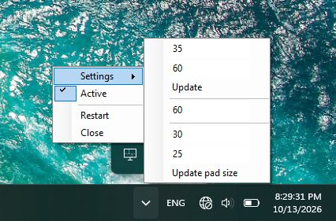

# diVider
An background app, to organize other applications on the screen

https://github.com/user-attachments/assets/2f87c3db-fcfd-46a0-b220-0f6b272fff0f

## Qiuick start

Usage is pretty straight forward:
1.  There is only one shortcut to remember:\
```LCtrl + LWin```\
shows one green and four red rectangles (called *markers*), with size of previously appended sizes.\
Green one follows directly under the mouse pointer, and red ones stay close, as markers for better fit.
2. First click summons gray one exactly in green's position, and locks markers preventing from moving.
3. Second click determines second corner of new size.

diVider creates notifyIcon, which allows to modifies markers sizes in pixels or by number of columns.\


## Requirements:
- .NetFramework 4.0.0